# 高强混凝土工程应用图集

按**建筑、桥梁、水利、海洋、国防**五类应用场所整理，每个工程配 1–2 张实景照片，并注明地点、建造时间和高强混凝土用在哪里。

- Word 版：[`高强混凝土工程应用图集.docx`](高强混凝土工程应用图集.docx)（A4，17 页，含一览表、全部照片、图注署名和资料来源链接）。
- 照片按类别放在 5 个文件夹里，宽 1280 px，可以直接放进 PPT 或报告；[`00_总览.jpg`](00_总览.jpg) 是全部照片的缩略图总览。
- 照片全部来自 Wikimedia Commons，采用知识共享许可（CC BY、CC BY-SA、CC0 或公有领域），可用于课件和报告，使用时按每张照片下面的“照片”一行署名。
- 第一类前 3 个是 UHPC 建筑，风格和参考图最接近（参考图本身的出处见文末）。

> **概念**
> - **高强混凝土**：强度等级不低于 C60 的混凝土（JGJ/T 281-2012《高强混凝土应用技术规程》）。
> - **超高性能混凝土（UHPC）**：抗压强度一般在 120 MPa 以上，掺钢纤维，能做成很薄的曲面板、镂空格栅和细长柱，参考图那类“轻盈”的混凝土建筑多用它。

## 一览表

| 类别 | 工程 | 地点 | 建造时间 | 高强混凝土用在哪 |
|---|---|---|---|---|
| 建筑工程 | [欧洲与地中海文明博物馆（MuCEM）](1_建筑工程/01_MuCEM_法国马赛_2013.jpg) | 法国 马赛 | 2010 年 9 月开工，2013 年 4 月完工，2013 年 6 月开馆 | UHPC 镂空网格外墙和屋面、树形柱、人行桥 |
| 建筑工程 | [路易威登基金会艺术中心（Fondation Louis Vuitton）](1_建筑工程/02_路易威登基金会_法国巴黎_2014.jpg) | 法国 巴黎 16 区 | 2008 年 3 月开工，2014 年 10 月 20 日落成、27 日对公众开放 | 约 1.9 万块白色 UHPC 曲面外墙板 |
| 建筑工程 | [让·布安体育场（Stade Jean-Bouin）](1_建筑工程/03_让布安体育场_法国巴黎_2013.jpg) | 法国 巴黎 16 区 | 2010 年 10 月–2013 年 6 月施工，2013 年 8 月 30 日启用 | 约 3,600 块三角形 UHPC 板构成外立面和屋面 |
| 建筑工程 | [哈利法塔（Burj Khalifa）](1_建筑工程/04_哈利法塔_阿联酋迪拜_2010.jpg) | 阿联酋 迪拜 | 2004 年 1 月开工，2010 年 1 月 4 日启用；高 828 m | 墙、柱用 C80 和 C60，2007 年泵送到 601 m |
| 建筑工程 | [吉隆坡石油双塔（Petronas Twin Towers）](1_建筑工程/05_吉隆坡石油双塔_马来西亚_1998.jpg) | 马来西亚 吉隆坡 | 1993 年 3 月开工，1996 年结构完工，1999 年 8 月正式启用；高 452 m | 核心筒和周边柱用 80 MPa 高强混凝土 |
| 建筑工程 | [上海中心大厦](1_建筑工程/06_上海中心大厦_上海_2015.jpg) | 中国 上海 浦东陆家嘴 | 2008 年 11 月 29 日开工，2013 年 8 月结构封顶，2015 年竣工；高 632 m | 巨型柱底部用 C70 |
| 建筑工程 | [广州国际金融中心（广州西塔）](1_建筑工程/07_广州国际金融中心_广州_2010.jpg) | 中国 广州 天河区珠江新城 | 2005 年开工，2010 年建成；高 438.6 m，103 层 | 大量使用 C70–C90，C100 泵送到 411 m |
| 建筑工程 | [天津高银 117 大厦](1_建筑工程/08_天津117大厦_天津_2015封顶.jpg) | 中国 天津 西青区 | 2008 年 9 月开工，2015 年 9 月主体结构封顶后停工；2025 年 4 月复工，目标 2027 年完工 | 混凝土泵送高度 621 m（吉尼斯纪录） |
| 桥梁工程 | [米约高架桥（Millau Viaduct）](2_桥梁工程/01_米约高架桥_法国_2004.jpg) | 法国 南部 阿韦龙省 米约 | 2001 年 10 月开工，2004 年 12 月 16 日通车；全长 2,460 m | 7 个桥墩用 B60 高性能混凝土，最高约 245 m |
| 桥梁工程 | [仙游桥（和平之桥，Seonyu Footbridge）](2_桥梁工程/02_仙游桥_韩国首尔_2002.jpg) | 韩国 首尔 汉江 | 2002 年 4 月建成 | 跨度 120 m 的 UHPC 拱 |
| 水利工程 | [小浪底水利枢纽](3_水利工程/01_小浪底水利枢纽_河南_2001.jpg) | 中国 河南 洛阳与济源之间的黄河干流 | 1994 年 9 月主体工程开工，2001 年底主体完工（2009 年通过国家竣工验收） | 泄洪排沙洞群衬砌用 C70 硅粉混凝土 |
| 海洋工程 | [联邦大桥（Confederation Bridge）](4_海洋工程/01_联邦大桥_加拿大_1997.jpg) | 加拿大 诺森伯兰海峡 | 1993 年 10 月开工，1997 年 5 月 31 日通车；全长 12.9 km | 海洋环境高性能混凝土 60 MPa，防冰锥 90 MPa |
| 海洋工程 | [海德伦张力腿平台（Heidrun TLP）](4_海洋工程/02_海德伦张力腿平台_挪威_1995.jpg) | 挪威 挪威海 Heidrun 油田 | 1995 年安装投产 | 整个平台船体用高强轻骨料混凝土 |
| 国防工程 | [加固飞机掩体（防护工程示意）](5_国防工程/01_加固飞机掩体_示意.jpg) | 意大利 焦亚德尔科莱空军基地（照片） | 照片摄于 2011 年 | 掩体、指挥所、发射井、防护门等防护结构 |

## 一、建筑工程

### 欧洲与地中海文明博物馆（MuCEM）

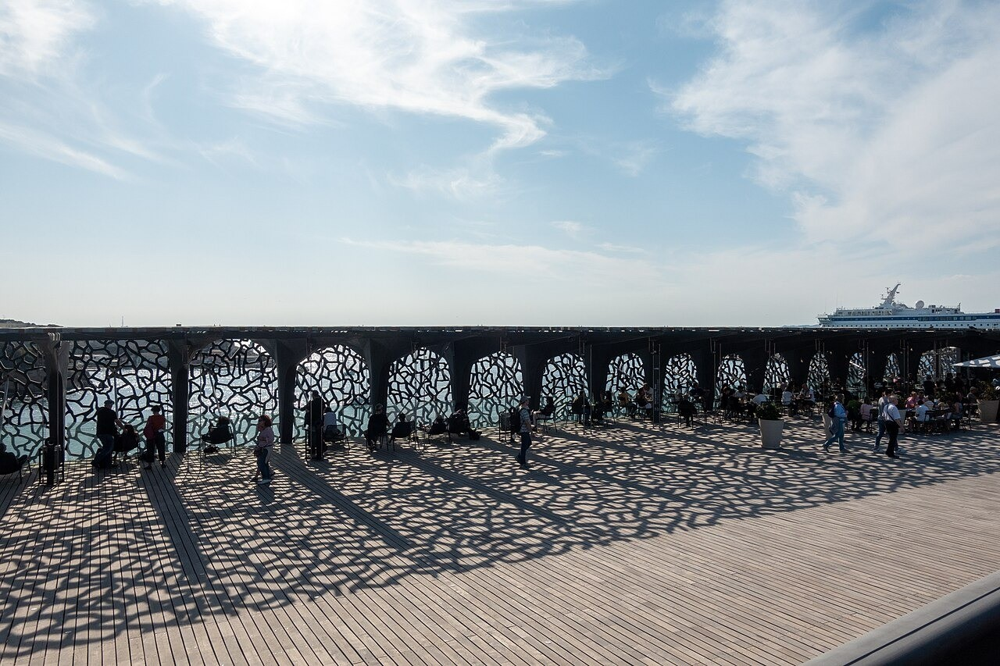

- **地点**：法国 马赛，旧港入口的 J4 码头
- **建造时间**：2010 年 9 月开工，2013 年 4 月完工，2013 年 6 月开馆
- **高强混凝土应用**：建筑师 Rudy Ricciotti。大面积使用 Ductal® 超高性能混凝土（UHPC）：南、西立面和屋顶外包一层仿阿拉伯花窗的 UHPC 镂空网格；支撑立面的是一排树形 UHPC 预制柱（全高施加预应力）；连接圣让堡的约 115 m 人行桥也是 UHPC。常被称为第一座大规模使用 UHPC 的大型建筑。
- **照片**：Kent Wang from Barcelona, Spain，CC BY-SA 2.0，[Wikimedia Commons](https://commons.wikimedia.org/wiki/File:Museum_of_European_and_Mediterranean_Civilisations_%2852113517827%29.jpg)
- **资料来源**：[AFGC 2013 UHPFRC 会议论文](https://afgc.asso.fr/app/uploads/2014/01/pp-3-16-Mazzacane.pdf)；[Freyssinet 项目介绍](https://www.freyssinet.com/case-study/mucem-post-tensioning)；[SCIA 项目介绍（工期）](https://www.scia.net/en/user-stories/mucem)

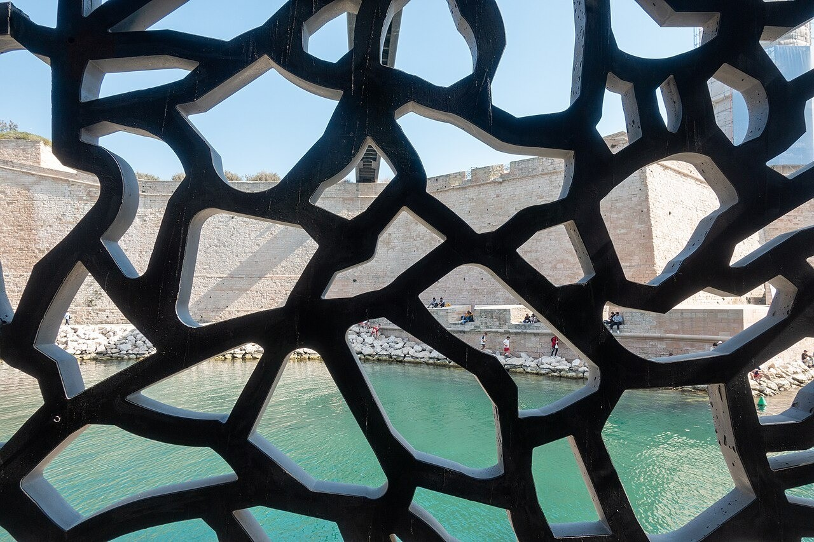

*近景：透过 UHPC 镂空网格看对岸的圣让堡*（照片：Kent Wang from Barcelona, Spain，CC BY-SA 2.0，[Wikimedia Commons](https://commons.wikimedia.org/wiki/File:Museum_of_European_and_Mediterranean_Civilisations_%2852114792274%29.jpg)）

### 路易威登基金会艺术中心（Fondation Louis Vuitton）

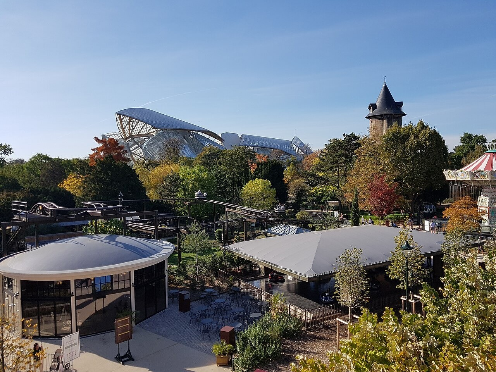

- **地点**：法国 巴黎 16 区，布洛涅森林
- **建造时间**：2008 年 3 月开工，2014 年 10 月 20 日落成、27 日对公众开放
- **高强混凝土应用**：建筑师 Frank Gehry。玻璃“帆”下面的建筑主体（俗称“冰山”）外墙包覆约 19,000 块白色 Ductal® UHPC 曲面板，几乎每块形状都不同，面积约 9,000 m²，用真空成型工艺预制。照片从旁边的儿童乐园拍摄，远处玻璃“帆”下面的白色块体就是 UHPC 板包覆的部分。
- **照片**：Moktarama，CC BY 3.0，[Wikimedia Commons](https://commons.wikimedia.org/wiki/File:Fondation_Louis_Vuitton_5.jpg)
- **资料来源**：[LVMH 介绍](https://www.lvmh.com/en/commitment-in-action/for-philanthropy/the-fondation-louis-vuitton)；[VINCI 落成新闻](https://www.vinci.com/en/newsroom/news/inauguration-louis-vuitton-foundation)

### 让·布安体育场（Stade Jean-Bouin）

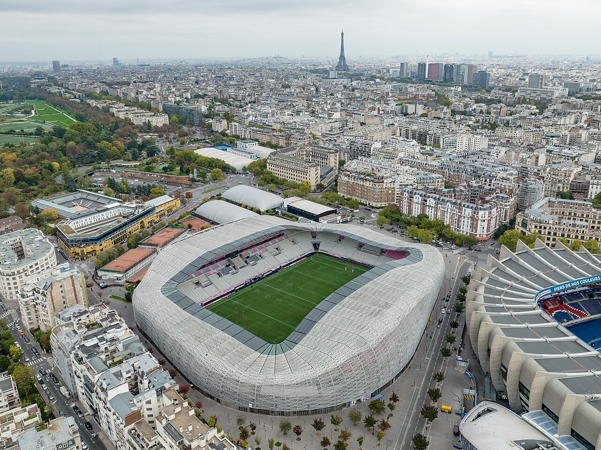

- **地点**：法国 巴黎 16 区，王子公园球场旁
- **建造时间**：2010 年 10 月–2013 年 6 月施工，2013 年 8 月 30 日启用
- **高强混凝土应用**：建筑师 Rudy Ricciotti，约 2 万座。外立面和防水屋面由约 3,600 块自承重的三角形 Ductal® UHPC 预制板组成（部分镶玻璃），面积约 2.1–2.3 万 m²，只用了 18 套模具。照片是航拍，白色网状外壳就是 UHPC 板。
- **照片**：Arne Müseler，CC BY-SA 3.0 de，[Wikimedia Commons](https://commons.wikimedia.org/wiki/File:Paris_Stade_Jean-Bouin.jpg)
- **资料来源**：[ArchDaily 产品案例](https://www.archdaily.com/catalog/us/products/15443/uhpc-panels-on-jean-bouin-stadium-ductal)；[AFGC 2013 UHPFRC 会议论文](https://afgc.asso.fr/app/uploads/2014/01/pp-59-68-Mazzacane-1.pdf)；[巴黎市政府介绍](https://www.paris.fr/pages/le-stade-jean-bouin-maison-du-rugby-et-du-football-33346)

### 哈利法塔（Burj Khalifa）

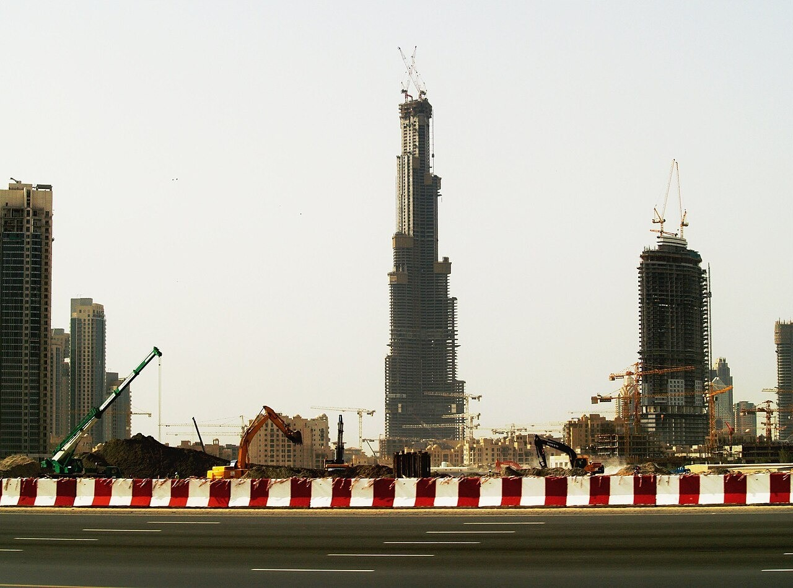

- **地点**：阿联酋 迪拜
- **建造时间**：2004 年 1 月开工，2010 年 1 月 4 日启用；高 828 m
- **高强混凝土应用**：钢筋混凝土核心筒和墙、柱底部用 C80（约到 126 层），以上用 C60；2007 年 11 月把混凝土泵送到 601 m 高，创当时世界纪录，32 个月共泵送约 16.5 万 m³ 高强混凝土。照片摄于 2007 年施工期间，能看到正在升高的钢筋混凝土主体。
- **照片**：Zaneyboy at English Wikipedia，CC BY-SA 3.0，[Wikimedia Commons](https://commons.wikimedia.org/wiki/File:Burjdubaifeb2107.jpg)
- **资料来源**：[Putzmeister 项目介绍](https://www.putzmeister.com/web/turk/success-story-detail/-/asset_publisher/burj-khalifa-dubai-united-arab-emirates)；[Arabian Business：How Burj was built](https://www.arabianbusiness.com/how-burj-was-built-9706.html)；[BNP Media 继续教育课程](https://continuingeducation.bnpmedia.com/courses/areditorial/beyond-limits/2)

### 吉隆坡石油双塔（Petronas Twin Towers）

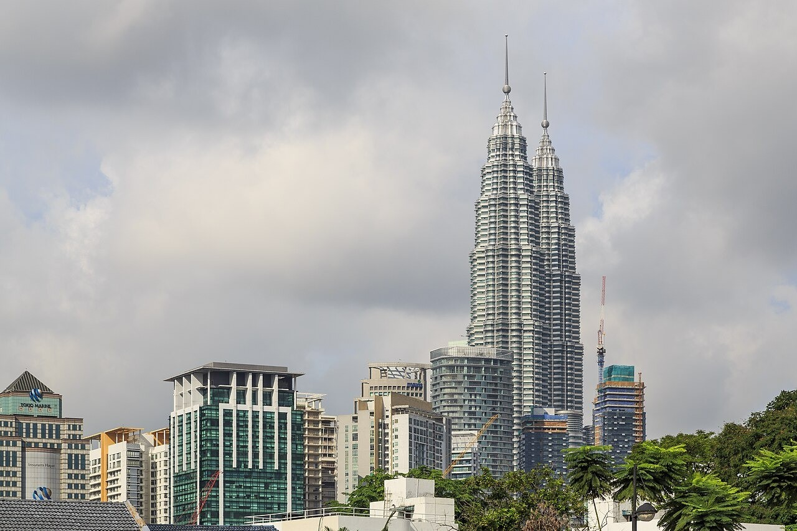

- **地点**：马来西亚 吉隆坡
- **建造时间**：1993 年 3 月开工，1996 年结构完工，1999 年 8 月正式启用；高 452 m
- **高强混凝土应用**：每座塔的核心筒和周边圆柱底部用 80 MPa（Grade 80）高强混凝土，向上分级降到 40 MPa，是当地第一次大规模使用 80 MPa 混凝土。1998–2004 年是世界最高建筑。
- **照片**：CEphoto, Uwe Aranas，CC BY-SA 3.0，[Wikimedia Commons](https://commons.wikimedia.org/wiki/File:Kuala_Lumpur_Malaysia_Petronas-Twin-Towers-01.jpg)
- **资料来源**：[ACI：The Petronas Twin Towers and High-Performance Concrete](https://www.concrete.org/publications/internationalconcreteabstractsportal/m/details/id/6140)；[TRID 摘要](https://trid.trb.org/view/476550)

### 上海中心大厦

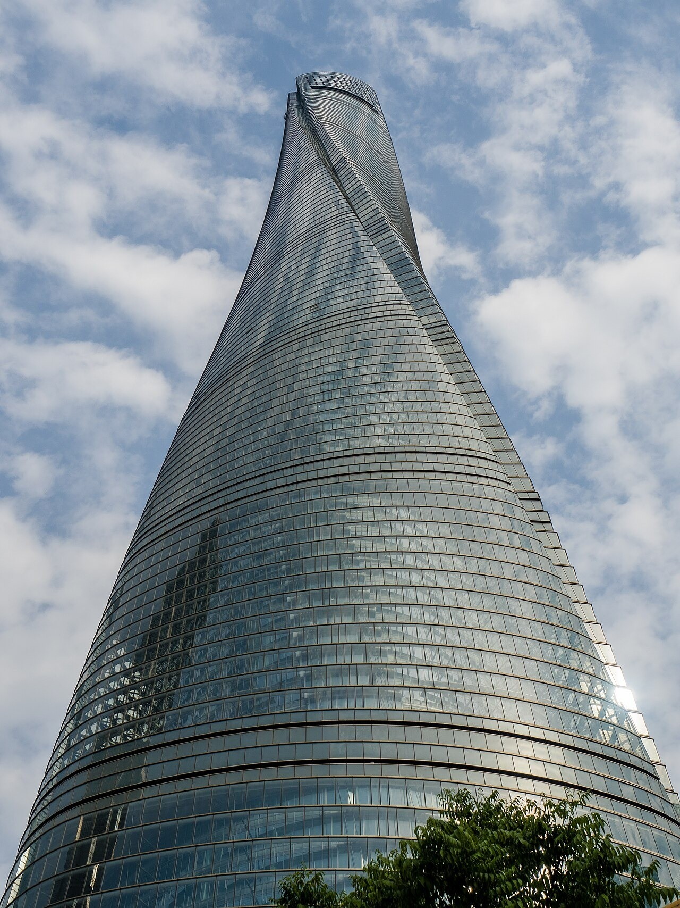

- **地点**：中国 上海 浦东陆家嘴
- **建造时间**：2008 年 11 月 29 日开工，2013 年 8 月结构封顶，2015 年竣工；高 632 m
- **高强混凝土应用**：结构为“巨型框架–核心筒–伸臂桁架”体系，8 根巨型柱是型钢混凝土柱，底部采用 C70 高强混凝土来减小截面，截面随高度逐级缩小。
- **照片**：Ermell，CC0，[Wikimedia Commons](https://commons.wikimedia.org/wiki/File:Shanghai_Shanghai_Tower_5166304.jpg)
- **资料来源**：[同济大学案例（Construct Steel）](https://constructsteel.org/steel-solutions/steel-composite-concrete-solution/building/column/complex-building-in-shanghai-shanghai-tower/)；[Structurae](https://structurae.net/en/structures/shanghai-tower)

### 广州国际金融中心（广州西塔）

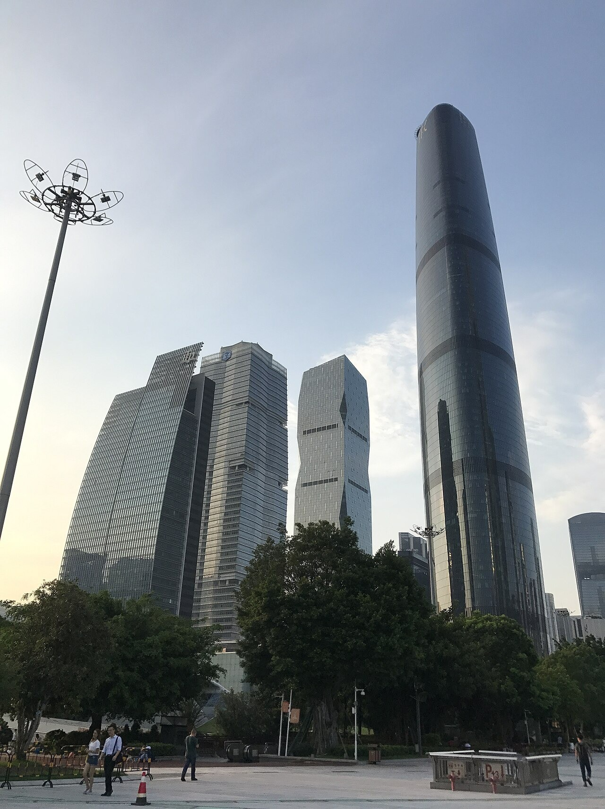

- **地点**：中国 广州 天河区珠江新城
- **建造时间**：2005 年开工，2010 年建成；高 438.6 m，103 层
- **高强混凝土应用**：结构为钢管混凝土斜交网格外筒加钢筋混凝土核心筒，大规模使用 C70–C90 高强混凝土；施工中研制了 C100 超高性能混凝土并泵送到 411 m 高度。
- **照片**：そらみみ，CC BY-SA 4.0，[Wikimedia Commons](https://commons.wikimedia.org/wiki/File:Guangzhou_International_Finance_Center_from_Huacheng_Square.jpg)
- **资料来源**：[XU Libin 2015 学位论文（西塔 C70–C100 混凝土）](https://library.iukl.edu.my/thesis/repository/browse/download/2015/XU%20LIBIN/2015_XU%20LIBIN.pdf)

### 天津高银 117 大厦

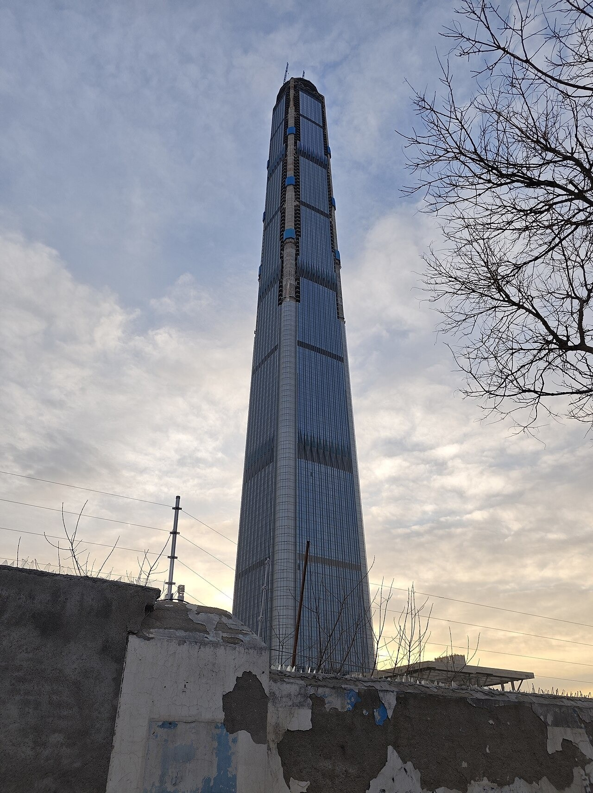

- **地点**：中国 天津 西青区
- **建造时间**：2008 年 9 月开工，2015 年 9 月主体结构封顶后停工；2025 年 4 月复工，目标 2027 年完工
- **高强混凝土应用**：2015 年核心筒封顶时混凝土实际泵送高度达到 621 m，超过哈利法塔的 601 m，创吉尼斯世界纪录；最后一方 C60 高性能混凝土浇筑在 596.5 m 处。2026 年 3 月开始安装塔冠钢结构。
- **照片**：Chirion23，CC0，[Wikimedia Commons](https://commons.wikimedia.org/wiki/File:Tianjin_Goldin_Finance_117_January_2026.jpg)
- **资料来源**：[前瞻网 2015：621 米泵送纪录](https://www.qianzhan.com/indynews/detail/258/150909-c9a6c639.html)；[新华网 2026：塔冠吊装](https://www.news.cn/20260328/782210d1d1744c7cb634d5d919cfb5f7/c.html)；[中华网 2026：工程进度](https://news.china.com/socialgd/10000169/20260609/49538875.html)

## 二、桥梁工程

### 米约高架桥（Millau Viaduct）

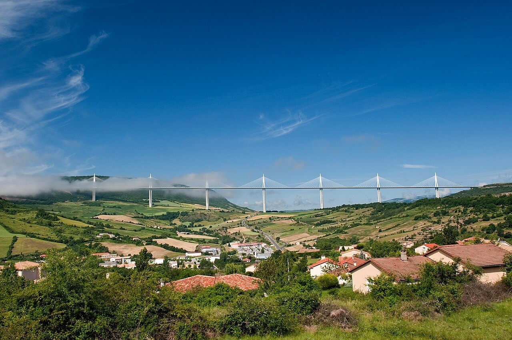

- **地点**：法国 南部 阿韦龙省 米约，跨塔恩河谷
- **建造时间**：2001 年 10 月开工，2004 年 12 月 16 日通车；全长 2,460 m
- **高强混凝土应用**：7 个桥墩采用 B60 高性能混凝土（约相当于 C60），最高的 P2 墩约 245 m，是世界上最高的桥墩；设计使用寿命 120 年。
- **照片**：Stefan Krause, Germany，CC BY-SA 3.0，[Wikimedia Commons](https://commons.wikimedia.org/wiki/File:Creissels_et_Viaduct_de_Millau.jpg)
- **资料来源**：[AFGC 论文（Arcadis）](https://www.afgc.asso.fr/app/uploads/2018/05/104-Hajar.pdf)；[Universalis 百科](https://www.universalis.fr/encyclopedie/viaduc-de-millau/)

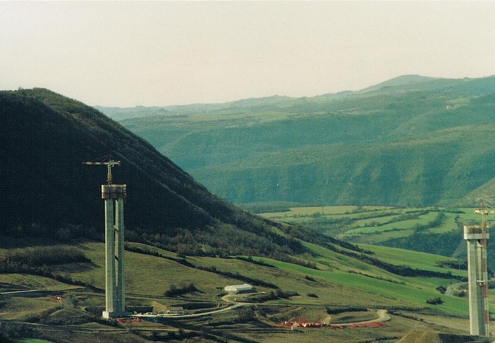

*2003 年 3 月施工中的 B60 高性能混凝土桥墩*（照片：Selmoval，CC BY-SA 4.0，[Wikimedia Commons](https://commons.wikimedia.org/wiki/File:2003_03_Construction_Viaduc_de_Millau_%285%29.jpg)）

### 仙游桥（和平之桥，Seonyu Footbridge）

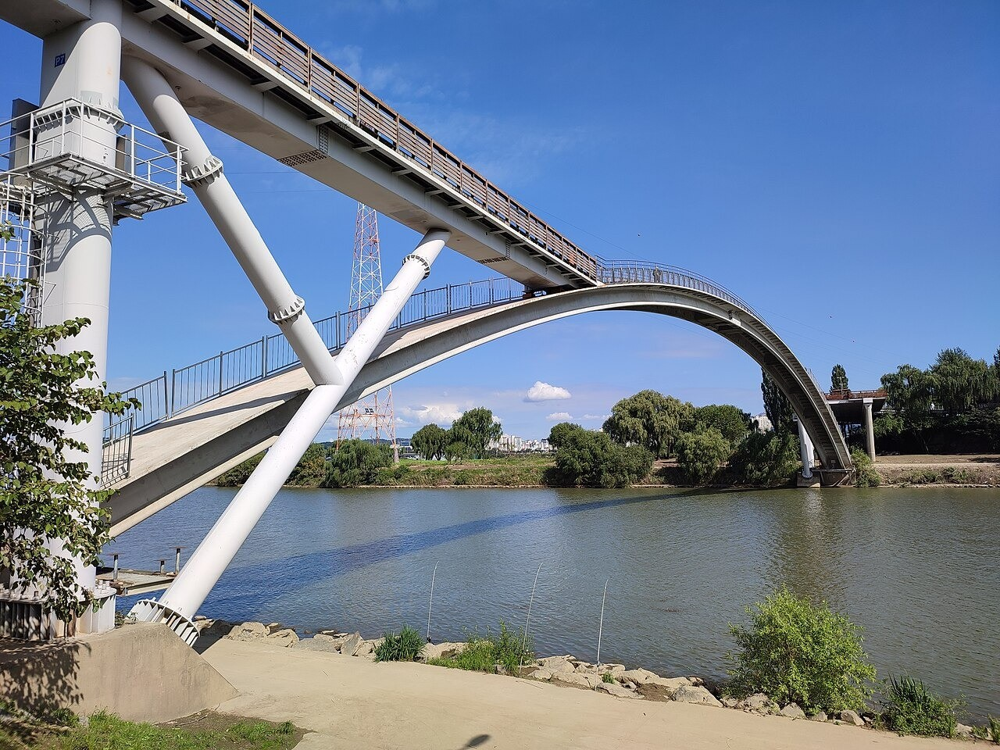

- **地点**：韩国 首尔 汉江，连接江岸与仙游岛公园
- **建造时间**：2002 年 4 月建成
- **高强混凝土应用**：建筑师 Rudy Ricciotti。主拱跨度 120 m，拱肋全部用 Ductal® UHPC 预制节段拼装，π 形截面、高 1.3 m，桥面宽 4.3 m，是早期最有代表性的 UHPC 桥之一。照片中白色细拱就是 UHPC 主拱。
- **照片**：Glabb，Public domain，[Wikimedia Commons](https://commons.wikimedia.org/wiki/File:Seonyu_Footbridge2.jpg)
- **资料来源**：[Structurae](https://structurae.net/structures/seonyu-footbridge)；[韩国混凝土学会论文](https://koreascience.kr/article/CFKO200111921193377.pub)

> **补充（没找到可自由使用的照片）**：舍布鲁克人行桥（加拿大魁北克省舍布鲁克，1997 年 7 月建成）是世界上第一座活性粉末混凝土（RPC）结构，60 m 跨的空间桁架，桥面和上下弦 RPC 抗压强度约 200 MPa，钢管约束的腹杆 RPC 约 350 MPa。见 [PCI Journal 1999](https://doi.org/10.15554/PCIJ.09011999.60.71)。

## 三、水利工程

### 小浪底水利枢纽

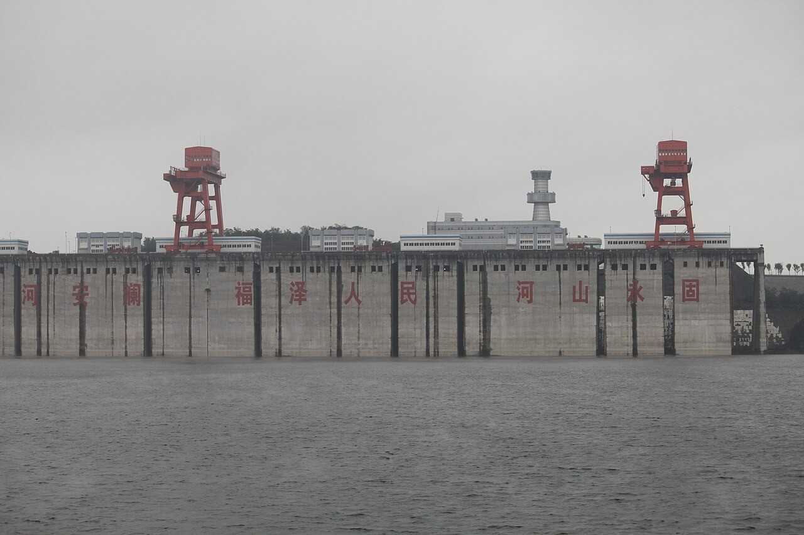

- **地点**：中国 河南 洛阳与济源之间的黄河干流
- **建造时间**：1994 年 9 月主体工程开工，2001 年底主体完工（2009 年通过国家竣工验收）
- **高强混凝土应用**：泄洪排沙建筑物工作水头 100–143 m，流速 30 m/s 以上，高含沙水流的磨损和空蚀很严重，所以孔板泄洪洞、排沙洞等过流部位大量采用抗冲耐磨的 C70 硅粉高强混凝土，浇筑量 30 多万 m³。照片是枢纽的进水塔群，孔板泄洪洞、排沙洞等隧洞都从这里进水，再穿过左岸山体。
- **照片**：Gary Todd，CC0，[Wikimedia Commons](https://commons.wikimedia.org/wiki/File:Xiaolangdi_Dam_Scenic_Area.jpg)
- **资料来源**：[《水利水电科技进展》论文（C70 硅粉混凝土）](https://jour.hhu.edu.cn/slsdkjjz/article/pdf/jz20020111)；[《水利水电科技进展》论文（裂缝与修补）](https://jour.hhu.edu.cn/slsdkjjz/article/pdf/jz20010114)；[人民日报 2024：主体工程开工 30 周年](https://paper.people.com.cn/rmrbwap/html/2024-09/12/nw.D110000renmrb_20240912_1-10.htm)

> **同类工程（无照片）**：溪洛渡水电站（金沙江，四川与云南交界，2005–2014 年建设）泄洪洞“龙落尾”段采用 C9060 硅粉混凝土（90 天强度 60 MPa），同样是为了抵抗高速水流的冲刷和空蚀，见论文《溪洛渡水电站泄洪洞龙落尾段 C9060 硅粉混凝土温控效果分析》。

## 四、海洋工程

### 联邦大桥（Confederation Bridge）

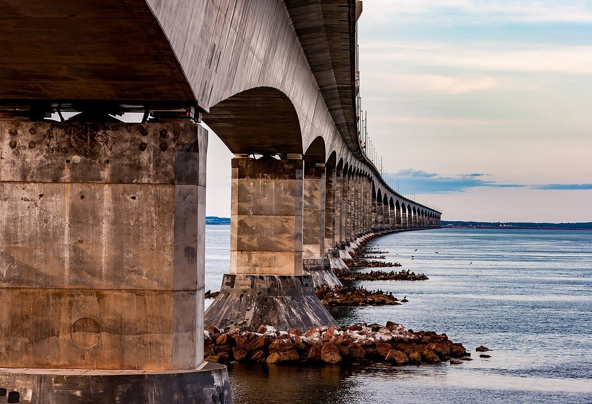

- **地点**：加拿大 诺森伯兰海峡，连接爱德华王子岛和新不伦瑞克省
- **建造时间**：1993 年 10 月开工，1997 年 5 月 31 日通车；全长 12.9 km
- **高强混凝土应用**：世界上跨越冰封海域最长的桥，常年受海水、海冰和冻融作用，设计寿命 100 年。主体高性能混凝土 28 d 强度 55 MPa、91 d 强度 60 MPa（7 种配合比，掺硅粉和粉煤灰）；桥墩水线处的防冰锥混凝土 28 d 强度达 90 MPa，用来抵抗海冰撞击和磨损。照片中桥墩底部的锥形部分就是防冰锥。
- **照片**：Michel Rathwell from Cornwall, Canada，CC BY 2.0，[Wikimedia Commons](https://commons.wikimedia.org/wiki/File:Bridge_PEI_%2836015481504%29.jpg)
- **资料来源**：[ACI Concrete International 摘要](https://www.concrete.org/publications/internationalconcreteabstractsportal/m/details/id/135)；[美国波特兰水泥协会案例](https://www.cement.org/Learn/concrete-technology/durability/case-histories)；[VINCI 项目介绍](https://www.vinci-construction-projets.com/en/realisations/confederation-bridge/)

### 海德伦张力腿平台（Heidrun TLP）

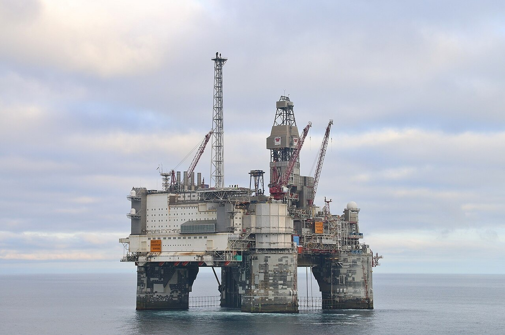

- **地点**：挪威 挪威海 Heidrun 油田，水深 345 m
- **建造时间**：1995 年安装投产
- **高强混凝土应用**：世界上第一座混凝土张力腿平台。船体由 4 根直径 31 m 的立柱和方形浮箱组成，全部用高强轻骨料混凝土建造，混凝土约 6.3 万 m³，排水量 28.8 万 t，由 16 根钢管张力腿锚固在海底的混凝土基础上。照片中托住上部模块的粗大立柱就是混凝土船体。
- **照片**：Norsk olje og gass，CC BY-SA 2.0，[Wikimedia Commons](https://commons.wikimedia.org/wiki/File:Heidrun%2C_Norskehavet_%2828276260560%29.jpg)
- **资料来源**：[OSTI：Heidrun 结构设计](https://www.osti.gov/biblio/433942)；[Oil & Gas Journal：World's first concrete TLP](https://ogj.com/home/article/17211441/world39s-first-concrete-tlp-takes-shape-off-norway)；[Multiconsult 项目介绍](https://multiconsultgroup.com/projects/heidrun-tlp)

## 五、国防工程

### 加固飞机掩体（防护工程示意）

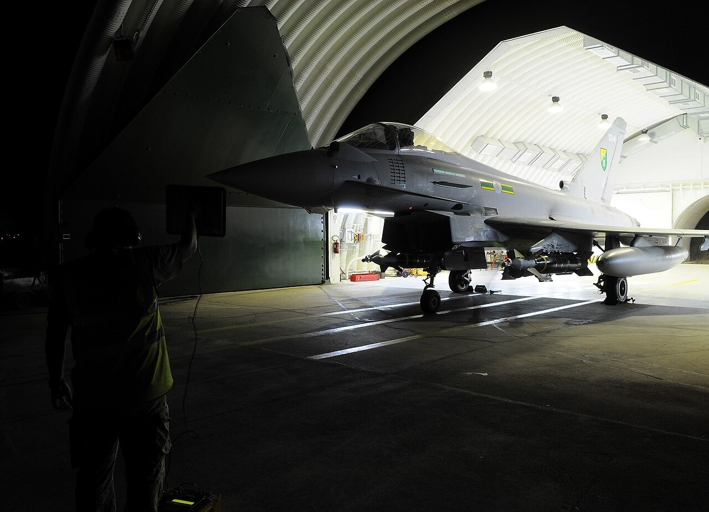

- **照片地点**：意大利 焦亚德尔科莱（Gioia del Colle）空军基地，一架英国皇家空军“台风”战机正驶出加固飞机掩体
- **时间**：照片摄于 2011 年 9 月
- **高强混凝土应用**：国防工程里，高强混凝土和 UHPC 主要用在防护结构上：飞机掩体、地下指挥所、导弹发射井、防护门、抗爆墙等，靠它的高强度和高韧性抵抗爆炸冲击和弹体侵彻。具体军事工程的混凝土等级一般不公开，这张照片只用来示意应用场所，不代表照片中这座掩体用了哪一级混凝土。公开资料方面：美国空军手册给出的典型掩体是约 460 mm 厚的钢衬混凝土；美国陆军工程兵研发中心（ERDC）从 1980 年代末开始研究 UHPC，开发了用于军事防护的 Cor-Tuf；国内多项试验也表明 UHPC 的抗侵彻、抗爆能力明显强于普通混凝土。
- **照片**：SAC Sally Raimondo，OGL v1.0，[Wikimedia Commons](https://commons.wikimedia.org/wiki/File:A_Royal_Air_Force_Typhoon_Taxiis_From_a_Shelter_at_Gioia_Del_Colle_Air_Base%2C_Italy_MOD_45153152.jpg)
- **资料来源**：[美国空军 AFMAN：Hardened Aircraft Shelters](https://stg.wbdg.org/FFC/AF/AFMAN/141182_Hardened_Aircraft_Shelters.pdf)；[ERDC 关于 Cor-Tuf UHPC 的研究](https://iastatedigitalpress.com/uhpc/article/9570/galley/9697/view)；[北京理工大学：弹体高速侵彻 UHPC 靶机理](https://pure.bit.edu.cn/zh/publications/%E5%BC%B9%E4%BD%93%E9%AB%98%E9%80%9F%E4%BE%B5%E5%BD%BB%E8%B6%85%E9%AB%98%E6%80%A7%E8%83%BD%E6%B7%B7%E5%87%9D%E5%9C%9F%E9%9D%B6%E6%9C%BA%E7%90%86/)

## 参考图出处

你发的参考图（环形屋檐、圆柱廊、黑色镜面水池、灰色 UHPC 质感）很可能是**深圳茅洲河水文教育展示馆**：同济大学建筑设计研究院（TJAD）设计，2020 年建成，约 1,500 m²，ArchDaily 介绍它的环形水院用了灰色 UHPC 质感。这个项目的照片是建筑摄影师的版权作品，所以没有下载，可以在 [ArchDaily 项目页](https://www.archdaily.com/953924/shenzhen-maozhou-river-hydrological-education-exhibition-hall-tjad) 查看。

国内同类的 UHPC 建筑还有杭州的**中国京杭大运河博物院**（赫尔佐格和德梅隆设计，据水泥供应商介绍外立面用了约 3.5 万 m² UHPC 预制板；2026 年 6 月报道二期工程已竣工验收），见 [Aalborg White 项目介绍](https://www.aalborgwhite.com/projects/hangzhou-grand-canal-museum-complex-uhpc-cladding) 和 [杭州网报道](https://hznews.hangzhou.com.cn/chengshi/content/2026-06/07/content_9235375.htm)。

## 照片说明

- 照片从 Wikimedia Commons 下载，只缩放到 1280 px 宽，没有做其他修改；每张照片的作者和许可写在各自条目的“照片”一行，点链接可以看原图和完整许可。
- CC BY / CC BY-SA 照片使用时要署名（作者 + 许可 + 来源）；CC0 和公有领域照片可以不署名，但注明来源更规范。
- 工程数据来自各条目列出的论文、报道和项目资料；不同来源的个别数字略有出入，正式引用时以原文为准。
